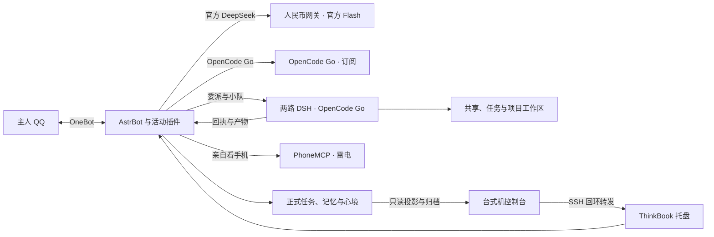

# FishHome 项目维护手册

**首版核查 2026-11-19，北京时间。** 本手册记录 FishHome 当前如何运行、故障从哪里查、修改后需要验证什么。需求编号与原始需求见 [PRD v0.9](PRD_FISH_HOME_v0.9.md)，已确认的产品决策见 [DECISIONS.md](DECISIONS.md)。下面的「现场」来自 ThinkBook 只读检查或注明日期的实际验收。「源码」表示接口存在。需要跨服务或真人操作才能证实的行为会注明待验证。

## 1. 维护约定

1. 动手前读相关小节，确认修改的是项目源码、正式机配置，还是正式运行数据。现场状态以 ThinkBook 的只读回读为准，验收报告用于追查当时的版本和条件。
2. 每次修改在同一变更中同步维护本手册。功能改动更新对应条目的入口、行为、开关或数据归属，验证后注明证据。部署更新正式状态和回退路径。纯内部改动在 [变更记录](#8-变更记录) 用一行写明影响与验证即可。
3. 详细步骤和测试证据留在对应专题，主手册保留当前结论和入口。修正旧结论时更新当前段落，保留历史报告及其日期。添加凭据的操作只记入口和保存状态。

### 已确认的资源原则

- **肥鱼的注意力和上下文有限。** 前台保留正常交流与亲自探索的空间。可委派的网页、视频整理、文件和代码工作优先考虑 Go。长任务在后台继续，肥鱼按需要看简报、证据和原文，或选择亲自核实。汇报频率服务于肥鱼的注意力。
- **OpenCode Go 的 token 按充足设计。** 正式 Go 任务使用订阅的 5 小时、周、月额度。调度设计应使用真实供应商反馈、同一会话的顺序要求，以及可验证的共享设备或资源冲突。当前的固定并发值列在 [DSH 与小队](#5-dsh-与小队)，后续要讨论如何移除缺乏依据的全局任务数和并发限制。
- 组会与无名工具派发的目标行为、理由及本轮待定问题见[决策记录](decisions-go-delegation-and-meetings.md)。
- 肥鱼本人的 QQ 私聊、自主模型和后台结果回报可在控制台统一切换。Go 使用官方订阅窗口，官方 Flash 使用独立的人民币交互和自主账本。旧 DSH 官方 DeepSeek 入口按实际路由归账。百炼语音和听写按各自提供商运行。权限、主动联系和共享文件写入由各自模块负责。

## 2. 机器、运行入口与权限（FR-09–FR-11，FR-15）

| 位置 | 职责与入口 |
| --- | --- |
| Windows 台式机 | `D:\Share\code\FishHome\repo` 是开发工作树。这里运行本地托盘、远程 ThinkBook 托盘和只读观测；接收归档到 `backups`、可读导出到 `exports`。台式机打开 `scripts/Open-ThinkBook-FishHome.cmd` 或紫色 TB 托盘，可通过已配对的 `fishbook` SSH 管理正式机。 |
| ThinkBook | `D:\FishHome\FishHome-ThinkBook-OneClick-Repair-v2-2026-11-12` 是当前安装根。根下 `repo` 保存已安装源码快照，当前没有 Git 工作树；`dev\astrbot-4.29.4\data\plugins` 是 AstrBot 插件的实际加载位置。正式 QQ、任务、记忆、心境与计费数据都以 ThinkBook 为准。 |
| Windows 登录和桌面 | FishHomeOps 登录后运行 `dev\FishHome.exe --background --start-all`。正式机实测仅登录 Ops 后托盘、桌面 broker、AstrBot、OneBot 和两路 DSH 恢复。桌面操作需要 Windows 交互会话处于解锁状态。雷电属于 GUI 服务，合盖需要 Windows 电源设置保持系统工作。 |
| 运行身份 | FishHomeOps 负责控制台的日常运行。FishHomeRunner 承担 DSH，FishHomeCompute 执行项目 Python，FishHomeDesktop 承担桌面操作。受保护组件安装或升级走 Windows 管理员入口；普通软件操作、编辑已有文件、凭据、公开发布分别有自己的权限边界。 |

- **11-19 现场**确认 12 项受管服务运行，OneBot 已连接。关键本机端口为 AstrBot `6185`、OneBot `6199`、NapCat `6099`、控制台 `6196`、人民币网关 `6197`、自主及受托 DSH `59934/59935`、桌面 broker `59937`、观察服务 `8767`、B 站伴侣 `8011`、PhoneMCP `8009`、Ollama `11434`。服务在线只证明连接层，用户路径看下方具体证据。 [控制台服务启动入口](../deploy/desktop_manager/manager.py)
- 控制端从本机回环访问，台式机用 SSH 回环转发。台式机本地观察页读取只读摘要，远程控制台的房间、星海入口转发正式机原版页面。手机局域网直达已暂缓。Linux 虚拟机是备用测试环境。 [远程控制台步骤](DESKTOP_MANAGER.md#从台式机打开-thinkbook-控制台) · [观测服务](../deploy/memory_observatory/server.py)
- 开发工作树使用 `feature/fish-affect-bridge`。公开发布使用独立 `payload/fishhome-public` 工作树的 `fish-home` 分支。公开分支、上游和正式机安装快照各自核对。 [代码同步与回退](CODE_SYNC.md)

## 3. 入口与运行状态（FR-01–FR-06，FR-08）

| 功能 | 实际运行路径与现场证据 |
| --- | --- |
| 主人 QQ 私聊、人格 | NapCat 经 OneBot 接 AstrBot，配置的唯一主人好友私聊进入 FishHome 工具。正式 ID 使用 `feiyu` 前缀，测试使用 `fish-home-`；配对版本保持同正文和工具配置。控制台「备份与记忆」切换后重开主人上下文；有分组能力的模块按人格分组。11-19 现场为正式分组。实际验收先切测试，再切回正式；同一 QQ 只在一台机器主动运行。 [人格切换实现](../deploy/desktop_manager/persona_mode.py) · [操作步骤](DESKTOP_MANAGER.md#切换正式与测试人格) |
| 心境与联系 | 原版 Affective Core 保管 `affective.db` 和动力学。FishAffectBridge 通过原接口接入事件和表达背景，联系消费者读取 `contact_drive`。正式机已见原生库、联系协调及实际联系账本；普通情绪提示、TTS 和表情的每个消费者是否实际采用心境，仍按各自链路验收。 [心境桥](../plugin/astrbot_plugin_dafeiyu_affect_bridge/main.py) · [接入记录](AFFECTIVE_BRIDGE_V11.md) |
| 自主生活、目标和工坊 | 现有活动插件调度 LifePlanner、活动、目标、跨日项目和工坊。周期调度、生活、决策、项目、工坊、生活记忆均已开启。正式机作息节律和独立自我表达开关关闭，免打扰为空。生活轮已有真实 B 站经历和自主休息记录；整个跨日项目生命周期及持续创作质量仍逐项验证。 [调度和工具](../plugin/astrbot_plugin_bili_activity/main.py) · [历史配置与验收](UNIQUE_LIFE_AUDIT_2026-11-14.md) |
| QQ 提醒、任务交付 | `/提醒` 创建、列出和取消；`/委托` 是主人明确派活入口。提醒、任务回执和普通聊天独立于主动联系暂停。11-17 断开 NapCat 时两条提醒进入出站队列，重连后依序各收到一次。11-18 真实确认长报告两段均送达并保留末行。未知送达留待核对。 [提醒实现](../plugin/astrbot_plugin_bili_activity/reminders.py) · [联合验收](dsh-v31/03_变更与逐项验收.md) · [长报告证据](DSH_TEAM_MEMORY_CHECKPOINT_2026-11-18.md) |
| QQ 图片、表情、语音和附件 | 普通图片和自定义表情视觉、QQ 旺柴表情、百炼合成与听写均有实际对话验收。自然语言可请求语音，是否用语音由肥鱼和当前工具决定。附件经主人消息进入 `shared/qq-inbox`，24 KiB 文本已真实导入并复验完整报告。任意 ZIP 的解包与受控 Python 读取共享文件还有权限和工具问题，详见 [待讨论](#7-已知问题与待讨论)。 [交互验收](OWNER_WORK_ACCEPTANCE.md) · [长文本与桌面操作记录](OPS_DESKTOP_AND_TEXT_READ_2026-11-18.md) |
| 手机、B 站和网页 | PhoneMCP／ADB 可截图、切页；B 站伴侣的接口登录态与模拟器 App 登录态独立。已实测 B 站首页、退出视频、原片抽帧及转写。公开视频和网页可先派 Go；用户可以要求肥鱼亲看，她也可以自行复核。代看报告与亲看经历分别保留来源。网页搜索摘要与已取得的正文按来源记录，网页正文抓取覆盖仍需专项验收。 [工具与计费接线](../plugin/astrbot_plugin_bili_activity/main.py) · [公开页抓取](../deploy/dsh_bridge/public_page.py) |
| 公共平台互动 | 正式机总开关关闭。启用后要经过平台支持、权限、审批与动作额度。B 站和抖音各有消费者及配置。没有证据表明标准账号或应用工具开关可以替代操作系统和网络层隔离。项目未确认其它社交 App 的独立接入。 [活动说明](../deploy/bili_activity/README.md) · [执行总闸](../deploy/bili_activity/service.py) |
| Windows 个人桌面与 Python | 独立入口覆盖项目 Python、支持的软件管理和桌面 broker。登记的程序已通过主人 QQ 查询、启动与正常关闭，含未保存内容的窗口已在真实桌面验证保留。Compute 项目目录可写，隔离验收中共享 QQ 收件箱对 Compute 拒读；Runner 对自身授权目录的访问是另一条执行路径。 [桌面记录](OPS_DESKTOP_AND_TEXT_READ_2026-11-18.md) · [工作区恢复与 ACL](THINKBOOK_RECOVERY_CHECKPOINT.md#新版工作区还原) |

### 控制台的「自主生活与主动联系设置」

下列数值是 11-19 在 ThinkBook 上读回的配置。日常以正式机控制台与配置为准。

| 控制项 | 读回值与生效含义 |
| --- | --- |
| 主动联系与 DND | 每日 5 次、未回复最多 2 次、基础冷却 90 分钟、主人发言后留白 5 分钟。心境可对两个基础时长乘 0.75 或 1.25。每日次数北京时间 00:00 重置，冷却可跨日。当前 DND 为已明确保存的空列表，未暂停。未配置的 `null` 会拦门，和空列表行为不同。 [联系门禁](../plugin/astrbot_plugin_bili_activity/contact.py) |
| 周期、分钟和次数 | 检查 120 ± 60 分钟，已排定的一次保留原时间。肥鱼常规生活轮每日 60 分钟、60 次模型调用、每轮 20 次；插件自主分享每日 5 次，同时受联系闸门约束。Go 内部模型调用按订阅计。 [生活预算](../plugin/astrbot_plugin_bili_activity/budget.py) |
| 自主 DSH、视觉与峰谷 | 开启生活轮派 Go 和自主视觉。大肥鱼本人选 Go 时，亲看的抽帧视觉也走 Go，解除原有人民币峰时等待与本地模型次数限制。切回官方 Flash 后，24,000 token 的峰时延期门槛继续用于部分亲自任务。本地生活时长、主动联系和平台操作限制继续生效。 [自主模型与视觉](../plugin/astrbot_plugin_bili_activity/main.py) |
| 项目、工坊、素材 | 项目名额 2（暂停也占用），新项目最多 3 阶段，复查 24 小时。工坊每轮 3 次修订、单件 12,000 字。共享目录素材无需逐件登记，除此之外可为两路分别登记文件名。 [项目实现](../plugin/astrbot_plugin_bili_activity/projects.py) · [设置写入](../deploy/desktop_manager/manager.py) |

## 4. 费用与闸门（FR-07、FR-07A–E）

| 路径 | 当前计量 |
| --- | --- |
| 官方 DeepSeek `deepseek-flash` | 肥鱼本人切回这条线路时使用交互、自主人民币账本。默认各 ¥5，11-19 正式机配置各 ¥3。按北京时间 **00:00** 换日，可在控制台设本预算日或默认额度。峰谷时段和费率由 `cost_window.py`、`fish_cost_prices.json` 提供。 [计费入口](../deploy/fish_cost.py) · [费率文件](../deploy/fish_cost_prices.json) · [时段规则](../plugin/astrbot_plugin_bili_activity/cost_window.py) |
| OpenCode Go | 肥鱼本人和正式 DSH 任务共用控制台保存的 Key 和官方订阅窗口，分别保留 AstrBot 会话与 DSH 回执。私聊、生活轮及其结果回报使用 Go 时跳过人民币账本。通过 `/go额度` 查询订阅，通过 `/额度` 查询人民币账本。旧官方 `anthropic` DSH 入口仍可按实际路由核对。 [切换入口](../deploy/desktop_manager/provider_mode.py) · [Go 文件回执](../deploy/dsh_bridge/go_file_gateway.py) |
| 百炼 | 语音合成、听写和部分音轨转写按自身配置及配额计。Go 视频的视觉与独立音轨转写是两段调用。正式机已保存音轨免费额度用完即停的确认。 [音轨实现](../deploy/dsh_bridge/media_asr.py) · [语音验收](OWNER_WORK_ACCEPTANCE.md) |

人民币预留是请求发出前的授权占用。可信用量回执按实际结算并释放差额；缺少回执会保留原预留。11-19 的聊天请求碰到了 ¥2.162688 的整窗预留门槛。11-20 网关改为支持的 OpenAI 请求按实际输入形状和输出上限报价，未知形状保留整窗策略。ThinkBook 真机对照的纯文字、工具与历史、内嵌图片三条请求，估算输入分别为 2,203、3,727、3,199 token，实际为 21、354、197 token。 [账本](../deploy/fish_cost_ledger.py) · [网关测试](../tests/test_fish_cost.py)

切换入口在 ThinkBook 控制台「人民币预算与凭据 → 大肥鱼本人模型」，台式机的 ThinkBook 远程控制台也可操作。保存 Go Key 后，人民币计费网关承担的 DSH 转发与 AstrBot 都在下次重启时读取新 Key。切换模型只重启 AstrBot，保留原私聊会话。

控制台在人民币交互／自主账本及生活设置的模型调用次数、峰谷阈值、视觉开关旁，按当前线路标明适用范围。官方 DeepSeek 线路仍使用保存的人民币设置。Go 跳过对应的计费和模型调用次数限制，生活时长、联系、分享和本机资源限制仍生效。AstrBot 的单轮步数和工具超时也继续生效；已经接受的异步 DSH 任务可以用原任务回执继续追踪。

Go 线路默认思考强度由真实模型调用参数决定。肥鱼本人的 AstrBot 对话和生活模型保留现行 `high`。FishHome 管理的两路 DSH 和临时公开资料工作进程使用原生 Go 预设，具名伙伴和无名工具默认 `max`。思考强度与本机运行时长、单轮步数及 Go 订阅窗口独立。 [DSH Go 预设](../deploy/dsh_bridge/go_profile.py)

台式机的 `--request-bounds` 使用 [官方 Flash 1017 模板](https://huggingface.co/deepseek-ai/DeepSeek-V4.1-Flash-1017/blob/08c8657f02291e11b6f6b63e0e16014f8e748518/encoding/README.md) 渲染文本、函数定义和历史工具结果，按渲染后的 UTF-8 字节保守计入输入，再加 2,048 token 的服务端余量。内联图片按 [官方图片上限](https://api-docs.deepseek.com/guides/vision/#token-usage) 每张预留 1,024 token，图片传输的 Base64 不计作正文。Anthropic 格式和未知扩展继续按整窗预留。托管服务的附加内容待实测核对，启用前保留整窗策略。启用后，出现超出估算的真实用量时，记录在原账本并恢复整窗；缺少用量时继续保留预留。 [预留计算](../deploy/fish_cost_prompt.py) · [计费入口](../deploy/fish_cost.py)

## 5. DSH 与小队

对应 FR-03–FR-06。

- **执行入口。** `/dsh ping` 查正式两路。肥鱼可自行使用 `df_dsh_submit_file`、`df_web_search`、`df_dsh_video` 等发起；主人明确委托默认走受托 DSH。请求回执与完成回执分开。普通聊天仍继续，后台完成后再回报；短报告能引回正文或成果。ThinkBook 两路共用 `D:\FishHome\workspaces\shared`，另有各自生活、委托及项目目录。 [Bridge 接线](../deploy/dsh_bridge/m3_qq.py)
- **小队身份。** 名字和人格版本绑定稳定 `agent_id`。普通聊天可以新开、切换、归档和恢复不同日常会话，任务和组会各自有 Session。工作指南按任务选择。11-18 真实确认新会话跨会话召回、旧会话切回、归档后用同一 ID 恢复、服务重启后续聊。 [异步聊天](DSH_ASYNC_CHAT.md) · [A–D 验收增量](DSH_TEAM_MEMORY_CHECKPOINT_2026-11-18.md)
- **组会。** 开会前确认类型、参与方式、成员、议题与材料、结果、结束条件和汇报方式，缺项合并询问。`style=casual` 允许先听、离场和自然散会；`style=discussion` 默认讨论到有依据的结论，结果可包含明确分歧。两种模式仅在明确要求时设置正整数的 `rounds` 或 `duration_minutes`，0 表示不限制。时间从实际开会起算，到时停止发起新发言并汇报已有结果，已发请求可按回执回查。正式讨论保留轮次及开轮快照。同一正式 DSH 会话留待核对时继续查原请求。 [会议调度](../plugin/astrbot_plugin_bili_activity/dsh_meetings.py)
- **组会发言与回执。** 正常成员可推进，迟到正文有原请求和新增 Go 回执时补记一次。明确结束且适合重做的只读发言可以自动再试；未确认结果沿原请求查回。闲聊默认不为普通散场呼叫肥鱼，明确求她拍板、结论需复核或按发起者选择汇报。主持人用 `post_kind=agenda` 改同一场会的议程，用 `continue` 明确续聊，并从 `post_receipt` 查是否会进入后续发言。 [组会工具](../plugin/astrbot_plugin_bili_activity/main.py) · [离线回归](../tests/test_dsh_meetings.py)
- **实时会场与共用会场。** ThinkBook 本机或台式机远程控制台的「近期组会 → 进入组会」、「组会会场」独立标签页、「DSH 会场」快捷入口和 DSH 原生侧栏共用同一份页面与插话接口。首次从已登录的控制台进入，页面会获得限于会场接口的本地浏览器登录状态。 [会场决策](decisions-live-meeting.md) · [会场源码](../deploy/desktop_manager/meetings.html) · [DSH 插件](../deploy/dsh_bridge/fishhome-meetings/client.js)
- **主人工作台。** 从服务页或 DSH 原生侧栏进入，直派网页、B 站和 Windows 专用桌面任务，报告及正文独立保存在控制台状态目录 `owner-work`。在「伙伴直聊」可用主人身份与当前名册中的伙伴交谈。两种发言者共用伙伴身份和伙伴长期记忆，聊天、当前指针及原始来源分别保存，主人直聊的记忆出处用 `owner-chat:`。派活和直聊结果由浏览器直接读取。 [入口说明](DESKTOP_MANAGER.md#dsh-主人工作台) · [主人工作接口](../deploy/desktop_manager/owner_work.py) · [直聊接口](../deploy/desktop_manager/owner_chat.py)
- **组会材料与回报。** 创建组会时可指定共享文本，或主人已收取的 QQ ZIP 及其中要读的文本条目。宿主核对来源后把读到的正文交给成员，原始文件保持不变。会议期间旁路异步聊天默认只交回肥鱼，只有主人明确要某条独立答复时才对该回合打开 `report_to_owner`。异步回报中发出的后续问题仍只在内部流转。正常组会按选定的间隔或散场规则记录。遇到 Go 回执未确认时保留原回合，下一轮给该成员新开原生会话并继续使用会议记录。
- **测试小队与散场投递。** 每次切入测试，控制台用同版本正式配置刷新大肥鱼的测试人格，并为活跃正式角色创建或更新独立测试身份的姓名和人设。测试 ID 固定，会话、记忆与正式角色分开。日常名册、聊天、组会、派活和记忆工具按当前组别工作，控制台可分别查看，测试角色和已归档角色默认折叠。主人明确要求散场私聊报告时，`report_on_close=true` 使用 QQ 队列提交一条，会议过程仍留在内部。
- **异步、记忆与来源。** 同一小弟的日常请求受历史顺序约束，多个小弟可各自执行。Go 回执缺失可进入待核对或额度等待，已推进的原生请求沿用原 ID 查回。小弟各自的长期记忆按稳定身份隔离，复用 LivingMemory 引擎及独立索引。肥鱼用自己的 LivingMemory，保留说话者、总结者、评价者与来源；其小队经历不混成主人偏好。11-18 真实验证组会来源跨小弟会话召回，以及肥鱼在新 QQ 会话查询双方约定。 [双向记忆协议](DSH_TEAM_MEMORY.md) · [历史与来源解析](../plugin/astrbot_plugin_bili_activity/team_history.py)
- **独立 Go 任务与无名工具。** 11-20 已部署到 ThinkBook。公开网页、视频和独立文件任务各自派发。列表展示最近 10 条，调度读取全部待执行任务。同一 Windows 桌面、共享写入目录或同名项目按资源排队。公开任务在 OpenCode 拒绝首个请求且无成功回执时，留原任务 ID 等官方额度恢复。肥鱼可从自主生活后台派发公开查证，具名伙伴可从聊天、文件任务或组会派发公开网页和 B 站视频查证。ThinkBook 测试人格下，实测同一伙伴派出的三条网页任务同时运行、全部完成，三份带来源及 Go 回执的原报告均可读回，伙伴在发起会话续答。`df_dsh_public_job` 的 `read_tool_report` 可凭父记录回查原报告。角色表达与文学主笔仍由角色决定。 [公开任务](../deploy/desktop_manager/public_jobs.py) · [文件调度](../plugin/astrbot_plugin_bili_activity/commissioned.py) · [委派协议](../plugin/astrbot_plugin_bili_activity/team_delegation.py)
- **本地无名子任务。** ThinkBook 已用测试人格和真实 Go 验证。从具名聊天、文件任务或组会派发 `file` 和 `python`，沿用正式 Go 队列，记录发起伙伴、父记录、原始素材和 Go 回执。宿主读取明确授权的文本，Python 子任务通过现有隔离 `run_python` 在临时环境执行。子任务可在父任务资料和权限内继续拆分，完整报告可按 `task:` 回查。用 `df_dsh_assign` 和任务 ID 查询、暂停、恢复或取消本地支线。实测暂停传到下级，独立支线完成，取消支线留在终态，恢复后隔离 Python 算出合计 5、最大项 pen，具名会话收到结果。 [任务控制](../plugin/astrbot_plugin_bili_activity/commissioned.py) · [隔离 Python 预设](../deploy/dsh_bridge/compute-preset.yml)
- **肥鱼看到的用法。** 主人私聊在文件工具可用时，由活动插件为当前请求提供 DSH 能力和登记素材提示，自主生活轮在对应工具启用时提供自己的提示。工具参数来自当轮工具定义。工作区里的《给大肥鱼的小弟与 DSH 使用指南》按需查阅。控制台帮助面向主人，可复用的工作指南由小队管理，按所选任务或会议送入具名会话。 [当前请求提示](../plugin/astrbot_plugin_bili_activity/main.py) · [任务指南](../plugin/astrbot_plugin_bili_activity/dsh_task.py)
- **角色资料。** 控制台分别管理文本角色卡、单人故事、多人故事与统一的他人印象。正文由模型阅读，角色名单和多人故事参与者由工具或界面选取。大肥鱼的多人故事和他人印象通过 `df_story` 按需读取，真实记忆另存。11-19 部署纯文本入口，随后在 ThinkBook 用隔离数据实测 16,006 字多人故事的分页读回。多人故事已解除 12,000 字限制，控制台仍有 256 KiB 单次上传请求上限。历史迁移包保留人物、版本、记录和记忆，以新身份导入。 [角色资料使用说明](DESKTOP_MANAGER.md#小弟角色卡) · [故事与角色卡实现](../plugin/astrbot_plugin_bili_activity/dsh_cards.py)
- **共同语言。** 控制台可预览、启停或更换 UTF-8 的 TXT／MD（最多 48 KiB）。默认启用《说话可以不急着说完》v1.0 原文。大肥鱼的消息和生活轮、具名小弟的日常聊天、组会及具名任务分别追加这段文字。保存后新发起的请求读取新设置。已有请求与聊天历史保留；无名工作进程保持原任务提示。控制台的改动保存在活动插件数据目录的 `shared-language.json`。 [语言层](../plugin/astrbot_plugin_bili_activity/shared_language.py)

### ThinkBook 资源基线

- 11-20 服务运行时采样。Ryzen 5 5600U（6 核 12 线程）、Radeon 集显，Windows 可用物理内存总量约 13.8 GiB。无公开网页或视频任务时，四次采样的可用内存约 7.3 GiB，CPU 约 4%–8%。D 盘剩余约 102 GiB。Ollama 没有驻留模型，SSH 会话无法取得 GPU 性能计数器。
- 用正式网页预设同时冷启动三个独立临时 DSH 工作进程。三者约 17.4–17.6 秒就绪，每个 Node 工作进程的常驻工作集约 400 MiB。整机可用内存最低从 7440 MiB 降至 6321 MiB，CPU 采样峰值约 48%。探针到本地连接为止，未调用模型或执行搜索，进程已退出。该结果可用于估算工作进程本身的开销，混合视频、Python 和本地模型负载待采样。 [网页工作进程](../deploy/desktop_manager/video_worker.py)
- 11-20 上线按本机资源分配。控制台独立网页、视频和桌面 DSH 工作进程最多同时冷启动 3 个，连通后归还名额。实测前 3 个约第 16 秒就绪，第 4 个等到第 16.2 秒才开始，最终 4 个同时在线。正式 B 站亲看和公开代看的本地取样（下载及 FFmpeg）共享一个时段。可用内存少于 3 GiB 时，这两类入口等待，最长 90 秒；超时回报本机资源繁忙。现有隔离计算服务一次处理一项 Python／PowerShell 请求，桌面、手机和同一写入目标沿用各自的互斥。Go 聊天、组会和已进入云端阶段的工作未加统一并发上限。Ollama 与视频、重计算同时运行的峰值待采样。 [媒体处理](../deploy/bili_activity/media.py) · [工作进程调度](../deploy/desktop_manager/video_worker.py)

## 6. 数据、备份和发布（FR-06、FR-10–FR-15）

| 权威位置或产物 | 用途 |
| --- | --- |
| AstrBot 的 `data/cmd_config.json`、`data_v4.db`、插件 `data/config` | 全局人格、模型、会话与插件设置。核心数据库可能含凭据类状态，普通备份按清单处理。 |
| 活动插件 `control.json`、`activity.sqlite3` | 活动与联系开关、活动/目标/工坊、QQ 投递、任务与会议、预算和 Go 回执。11-19 回读确认 `settings`、`runs`、`goals`、`creative_works`、`deliveries`、`contact_attempts`、`fish_cost_calls` 和 `go_file_receipts` 等表。 |
| LivingMemory、`dsh_team_memory`、`affective.db` | 肥鱼长期记忆、小弟长期记忆与情绪状态各有源库。数据库、索引和来源关系由对应原生组件维护。角色文本存在活动插件资料目录，会议、任务和 QQ 来源在各自原始记录。 |
| 控制台状态、DSH 工作区 | 控制台配置与日志位于正式账户 `%LOCALAPPDATA%\FishHome\manager`，私有凭据使用 DPAPI。Bridge `plugin_data/astrbot_plugin_dsh_bridge/m3.json` 包含正式通道设置和敏感本机连接字段。共享、受托、自主和项目文件归工作区保管。 |
| 普通备份、可读导出 | ThinkBook 托盘按日保存一致性快照，台式机托盘每 15 分钟补拉，自动归档按现行日/周/月策略轮换。Markdown/JSONL、房间摘要、星海投影供查看。常规设置同步只对控制台列出的配置项做三方比较，要求初次确认，发生冲突逐项处理。文件与 live SQLite 从独立的归档流程恢复。 |
| 私有快速还原包 | 包含 AstrBot 数据、NapCat、指定控制台状态和 DSH 工作区，包含敏感内容。11-18 已在正式机原账户、原路径验收 v2 覆盖、工作区权限及 QQ／DSH／房间恢复。跨 Windows 账户或重装后 DPAPI 绑定凭据需重填，外部账号登录态按模块恢复。 |

- 快照、归档、可读导出看 [维护脚本说明](../scripts/README.md)、[备份实现](../deploy/desktop_manager/backup_sync.py) 及 [正式恢复证据](THINKBOOK_RECOVERY_CHECKPOINT.md)。早期文档关于每天 Windows 计划任务的设计已由当前两端托盘机制替代。
- 发布前审查工作树和变更范围，按 [CODE_SYNC.md](CODE_SYNC.md) 核对公开分支、原作者与 ThinkBook 的安装位置。生产更新需明确授权。结束相关在途任务后留回退副本，安装到运行入口，按影响范围重启和验收。日常改动用原文件回退，涉及状态迁移时另用匹配的备份恢复。旧记录仍是回查证据，更新手册以当前验收结论为准。
- 离线验证按模块选测：费用 `test_fish_cost`，控制台与反代 `test_desktop_manager/test_thinkbook_console`，小队 `test_dsh_chats/test_dsh_meetings/test_team_memory_*`，生活和心境 `test_bili_life_integration/test_bili_planner/test_fish_affect_bridge`，恢复 `test_thinkbook_recovery`。真实验收记录实际入口、回执、产物和回读结果。 [全部测试](../tests/) · [验收证据模板](ACCEPTANCE.md#单条验收证据模板)

## 7. 已知问题与待讨论

| 问题 | 已知事实与讨论范围 |
| --- | --- |
| **组会并发、迟到回复和插话** | 11-19 凌晨第一场三轮完成，主人的「先随便聊」被排到不存在的第 4 轮。午间一场只入库第三个角色；第一个角色的上游流缺少 `finish_reason` 且无 Go 回执，第二个角色在 DSH 原始记录里有完整正文与新增回执，会议没收录。22:56 重开的会两轮六条发言都完成。11-20 修复已部署，实际 Go 三人发言与散会通知生成通过隔离验收。断流、迟到回执和末轮插话有离线回归。 |
| **旧私聊路由不一致** | 11-20 ThinkBook 核对了同批六条原记录。三条旧请求的实际原生会话在受托 DSH。原请求编号没有可匹配的原生终态，三条保留为 `needs_review` 并释放后续队列，未重新发送。原来排队的另外三条分别沿原会话完成、各有一个 Go 回执和一条已发送的 OneBot 回执。 |
| **无名工具权限与现场复验** | ThinkBook 已实测具名私聊并行派发网页、原报告回读及发起会话续答，也验证了具名文件任务委派网页和组会委派 B 站代看。11-20 主人 QQ 已核对已完成组会历史。后续实测本地文件、隔离 Python、子任务再拆以及支线暂停、恢复、取消全部通过。桌面资源争用时的主人优先仍待现场复验。研究 ZIP 取材与散场投递的后续验收见变更记录。 |
| **人民币预留与原报告交付** | ThinkBook 已用官方托管回执核对文字、函数定义及图片的预留，并启用按请求定价。离线回归覆盖低余额、并发、缺失用量和超出估算后的整窗回退。`/委托` 的已验证 Go 结果可在肥鱼回报失败时进入 QQ 队列，分段交付完整原文并标明肥鱼尚未复核。普通模型委派继续等待肥鱼处理。真实低余额 QQ 和真机回报回退仍待自然运行观察。 |
| **QQ ZIP 处理与共享工作区** | 第 4 项已发布并通过真实 QQ 验收。附件重发后成功收取，工具列出两项、读到 README 末行，只解包 `samples/tide.csv`。修复 Windows 目录未继承 Runner 权限的问题后，QQ 任务 `cb24b18d872f` 直接派文件验收角色读取 `shared/qq-zip/task-558v6ura/001-tide.csv`，报告合计 5、最大项 `pen,3`，5 条 Go 回执及 OneBot 自动投递均已确认。原 ZIP 保存完好，任务目录只含选中的 CSV。对于模型的原生 DSH 文件工具，已经在共享目录下时使用 `qq-zip/…` 相对路径；FishHome 派活入口继续使用带 `shared/` 的路径。 [验收测试](../tests/test_qq_zip_attachments.py) |
| **网页证据、媒体验证与持续运行** | 搜索和 Go 媒体已有真实回执。正文抓取需区分直接打开与摘要，并按各自执行结果验收。只读媒体工作进程跨重启完整续跑、长期跨日项目持续性、双机设置首次确认后自动冲突处理仍待现场证明。手机直达房间和星海、外部 B 站和贴吧 DSH 插件、公开平台写入继续按现有决定各自排期。 |

## 8. 变更记录

| 日期 | 范围、证据与回退 |
| --- | --- |
| 2026-11-25 | 升级组会会场（`meetings.html`）、伙伴直聊（`owner_chat.html`）、直接派活（`owner_work.html`）及 DSH 侧栏挂载插件（`fishhome-meetings/client.js`）为原生 DSH 明暗双主题风格。支持 `100dvh` 全高布局、可折叠左侧栏、纯 DOM Markdown 渲染、参会席位筛选、轮次分隔线、`Enter` 直发（直聊/会场，含中文 IME 防误触）、纪要复制/导出及 DSH 侧栏明暗主题实时同步。后端回归通过，本机 Chrome 实测两套页面暗色/亮色/嵌入态/480px 窄屏均通过且零报错。 [会场决策](decisions-live-meeting.md) |
| 2026-11-25 | 记录会场视觉改版方案 A 决策（原生 DSH 明暗双主题融合 + 多人组会专属增强），完成全项目只读审查并将 11-22 之后验证通过的主人工作台、语音与模型、B 站分段字幕/原音转写、主机资源、QQ 对话切换与开发入口整理同步至公开 `fish-home` 分支。核对 `upstream/main` 已包含全部最新提交（`6427435`）。 [会场决策](decisions-live-meeting.md) |
| 2026-11-22 | 整理开发入口。`AGENTS.md` 移除首轮 M0 指令，归拢双机、验收和发布规则，费用口径统一从本手册进入。M0 开工稿和 Fork 初始化指南移入 `docs/history/`。移除活动插件中无调用的旧文本折叠分支，新增可选的 20,000 字节暂存大小钩子（`.githooks/pre-commit`，默认未启用）。 [提交检查](CODE_SYNC.md#提交文件大小检查) |
| 2026-11-22 | 上线「总览 → 主机资源」与主人工作台刷新提示，通过控制台认证读取主机 CPU、内存、系统盘／项目盘和前五内存进程，支持断线保留与自动刷新。 [使用说明](DESKTOP_MANAGER.md#主机资源) |
| 2026-11-22 | 上线 DSH 主人工作台与伙伴直聊、语音与模型设置（含 Qwen-Audio 3.1 静音测试修复）、B 站短试看与分段 OCR（PP-OCRv5 Mobile）/ Silero VAD / 双 ASR（TXT/SRT 留档）以及 QQ 旧对话切换。 [操作说明](DESKTOP_MANAGER.md#dsh-主人工作台) |
| 2026-12-05 | 工业风工作台和会场、角色资料状态、B 站长视频分批已在 Windows 运行端上线。通过台式机浏览器验证新版、经典版、历史会场和角色资料状态。真实公开片按 290–590、590–620 秒取得 8＋8 帧，亲看所用伴侣按 200–500、500–505 秒取得 8＋2 帧。测试直达取材工具，QQ 发起到最终回复留待复验。运行端保留此次源码回退副本和恢复清单。 [改版决策](decisions-console-redesign.md) · [安装和回退](CODE_SYNC.md) |
| 2026-11-21 | DeepSeek 官方网页搜索已通过亲搜及 DSH 正文回读验证。两次付费搜索共计 ¥0.01，独立搜索分项已在控制台显示。 [搜索与计费](DESKTOP_MANAGER.md#人民币计费) |
| 2026-11-20 | 收尾整理控制台、Go、小队、组会、QQ ZIP 和记忆星海的代码与验收记录。公开发布保留共同语言功能，首次安装可在控制台上传自己的 TXT 或 Markdown；没有随包的语言文本时保持关闭。ThinkBook 当前已部署的文本继续由本机管理。公开工作树 187 项定向回归通过，另用 UTF-8 模式和 Git Bash 通过 79 项故事工具、生活项目及脚本复验。 |
| 2026-11-20 | 真实 QQ 测试组会 `374fae89688d8808` 使用独立测试第一个角色、第二个角色。同篇已收取文本中逐字找到第一个角色首轮引用的原句。一条散场报告进 QQ 队列，OneBot 最终状态 `sent`，附单条实际投递回执。这次旧逻辑把指定的一轮闲聊延长到 11 轮。新规则已发布到 ThinkBook，两种会议默认不限轮数和时间，只有明确要求时才加上限。对确认项不全的开会请求，提供缺项询问指引并在入口校验会议类型与参与方式。本机 80 项回归通过。独立用真实 Go 验证一轮闲聊按 `round_limit` 收场，无轮数上限的讨论按 `goal_ready` 收场。回退目录为 `before-meeting-round-cap-20261120-132542`，按路径清单恢复并重启 AstrBot。 |
| 2026-11-20 | 主人 QQ 重发研究 ZIP 后，测试组会 `0c401a2b60277836` 已读取选择的正文，第一个角色首轮包含 19 个连续可匹配正文字符。散场回执只记录了内部交回，QQ 投递没有入队。相关修复已部署。另发现正式第一个角色、第二个角色被旧名册调入测试，原回合分别留下 10 条、9 条长期记忆回执。原始记录保留，正式召回过滤测试会议来源。ThinkBook 验证了大肥鱼同版本配置一致、为三位活跃正式角色建立独立测试身份并拒绝用正式角色 ID 参与测试。89 项回归通过，覆盖测试人设更新沿用原测试 ID 和散场只入队一条。后续独立测试组会已取得 QQ 散场投递回执。回退使用运维目录 `before-test-roster-20261120-130545` 的路径清单，恢复文件后重启 AstrBot。 |
| 2026-11-20 | ThinkBook 真实 Go 小队联合验收通过。测试具名聊天派发三条独立支线，其中 Python 支线继续拆出文件子任务。暂停 Python 时其子任务同停，另一文件支线独立完成，第三条取消。恢复后隔离 Python 实际读取 `sample.csv`，第一次误把换行转义带入，工具随即检查并以正确原文重算，产物和原生退出码验证合计 5、最大项 pen。上级具名会话收到回报。证据见 ThinkBook 运维目录 `local-tools-acceptance-20261120.json`。 |
| 2026-11-20 | 组会材料、旁路聊天和代看修复已部署到 ThinkBook。原闲聊中第一个角色的 DSH 首轮看到 `Stream ended without finish_reason`，后续在同一原生会话被待核对用量拦住。会议现在保留失败回合，用新会话继续随后轮次。旧研究 ZIP 无 QQ 收取回执，原件保留。旧会议生成的 17 条未派旁路追问保留为 `held`，原行随回退副本保存。新旁路聊天默认内部交回，模拟 QQ 队列验证只有明示的独立回报进入待发。原视频 `BV16Q4c66EdT` 已在真实 Go 代看拿到 0、7.5 秒抽帧及订阅回执。两位测试成员用真实 Go 读出 ZIP 内指定文本的末行标记。85 项回归通过。回退目录是 ThinkBook `%LOCALAPPDATA%\FishHome\manager\before-meeting-repair-20261120-095814`，按 paths.txt 恢复后刷新控制台、预算转发和 AstrBot。 |
| 2026-11-20 | 本地无名文件与隔离 Python 接入现有任务队列。52 项本机回归通过，覆盖素材限制、重复派发沿用原记录、父子回执、递归拆分、暂停与恢复、取消和独立支线完成。ThinkBook 的实际隔离 Python 对合成 CSV 返回合计 5、最大项 pen。已更新 ThinkBook 的活动插件、控制台帮助及计算预设，测试人格启动通过。真实 Go 小队联合验收留到 Codex 额度恢复。ThinkBook 已在运维账户主目录准备 `fishhome-local-tools-run-20261120-0421.py`，从安装目录的 repo 用 AstrBot Python 运行，先切测试人格再以 `verify` 执行，脚本退出前恢复正式人格。回退清单及原文件位于 ThinkBook `%LOCALAPPDATA%\FishHome\manager\before-local-tools-20261120-0421`；恢复后依次启动 Compute、两路 DSH 和 AstrBot。 [回归测试](../tests/test_commissioned_files.py) |
| 2026-11-20 | 小队任务控制的本机回归 49 项通过。现有测试覆盖父文件任务暂停、恢复和向已派子任务传播取消，以及公开任务 A 取消后并行的任务 B 仍能完成。核对当前具名委派只开放网页和公开视频；将本地文件、隔离 Python 接为无名子任务，以及带范围的子任务再拆分，仍待实现和真机验收。 |
| 2026-11-20 | QQ 联合验收核对通过。文件验收角色从原解包路径完成 `cb24b18d872f`，得到 5 条 Go 回执及 OneBot 投递。主人另在 QQ 查询测试组会 `0a9f5272f4ae3283`，ThinkBook 在北京时间 03:55:57 记录 `df_dsh_meeting(action=get)`；回复的已完成状态、两轮四条发言和两位成员的判断可从原记录回查。随后恢复正式人格 `feiyu-v3.0`，QQ、两路 DSH 与 Go 线路正常。 |
| 2026-11-20 | ThinkBook 控制台按实际模型线路标注人民币账本、模型调用次数、峰谷阈值及视觉开关。两路 DSH 和临时 Go 工作进程的原生默认思考强度设为 `max`，肥鱼本人保留 `high`。合成 Go 请求验到两个强度均成功，临时 DSH 实测上游载荷为 `max`、计费为 Go，正式两路模型目录也读回 `max`。证据与回退副本位于 ThinkBook `%LOCALAPPDATA%\FishHome\manager`，文件名分别为 `go-reasoning-default-20261120.json`、`before-go-limit-labels-20261120-034220.html`、`before-dsh-go-effort-20261120-034721.py`。14 项相关测试通过。 |
| 2026-11-20 | 测试人格下完成真实 QQ ZIP 收件、列清单、指定文本读取、单项解包，并在 ThinkBook 复验具名小弟实际读与写报告。原附件逐字节相同。Windows ACL 与后台诊断修复通过 36 项定向测试，任务源读取失败现在保留原生会话和 `source_read` 原因。证据在 ThinkBook `%LOCALAPPDATA%\FishHome\manager\zip-runner-acceptance-20261120.json`。源码回退目录 `before-zip-runner-acl-20261120-033339` 对应修复前，后续回退副本 `before-zip-runner-acl-20261120-033619` 对应本轮第一版修复。QQ 联合验收使用测试人格。 |
| 2026-11-20 | QQ ZIP、共同语言和本机资源调度一起部署到 ThinkBook。正式 QQ、两路 DSH 和 B 站伴侣恢复，肥鱼保持 Go。ThinkBook 的已装插件用隔离附件核对 ZIP 列表、正文、选择性解包和 DSH 路径，核对组会和具名任务保留原人格，也验证 Windows 媒体槽互斥。相关本机回归共 195 项，189 通过、6 跳过。证据在 ThinkBook `%LOCALAPPDATA%\FishHome\manager\zip-language-capacity-20261120.json`。回退目录为同级 `before-zip-language-capacity-20261120-031653`，按清单恢复源码及重启本轮服务，保留 QQ 附件、任务和人格。 |
| 2026-11-20 | 第 4 项 QQ ZIP 取材完成本机实现。测试用 QQ 附件替身走收取、清单分页、读取至文件末尾、选择性解包和 DSH 素材路径验证；涵盖原件保留、其他会话拒绝和不安全成员拒绝。面板「使用帮助」已补用法。发布更新 Bridge 的 `main.py` 与 `qq_zip.py`、活动插件 `main.py` 和控制台页面；回退使用对应旧源码，保留原附件和已有解包文件。 |
| 2026-11-20 | 第三阶段发布至 ThinkBook，人民币网关确认按请求预留已开启。AstrBot 会话头插件 v1.3.1 的合成文字、图片和原生自动工具调用均实际收到 Go 订阅回执，按量费为 0。强制工具选择参数 `tool_choice=required` 返回 400，现行 AstrBot Agent 使用 `auto`。正式控制台回读 Go → DeepSeek → Go，台式机实测 SSH 转发后的选择页及接口，重启后两路 DSH、OneBot 和正式人格恢复。模型与 QQ 连接证据在 ThinkBook `%LOCALAPPDATA%\FishHome\manager\fish-model-go-acceptance-20261120.json`，官方用量样本在同目录 `stage3-real-deepseek-20261120.json`。快速回切使用控制台。若需回退代码，`before-fish-go-20261120-023134` 含路径清单、原配置和原主人私聊模型设置，恢复时保留后续任务和记忆数据库。台式机相关回归 196 项通过。 |
| 2026-11-20 | 第二阶段剩余链路真机复验。具名文件任务完成网页工具委派、产出回读和 3 个 Go 回执。组会完成两人发言、生成完成通知，并读回具名成员委派的 B 站 1.0 秒抽帧报告及其 3 个 Go 回执。复验使用独立活动库和测试人格，随后恢复正式人格。证据在 ThinkBook `%LOCALAPPDATA%\FishHome\manager\stage2-cross-acceptance-20261120-015816.json`。同轮台式机完成第三阶段计费与明确 `/委托` 的原报告回退，80 项相关离线回归通过，也核对了零余额 402 后原报告一次入队。第三阶段尚未发布，生产网关仍使用原策略。 |
| 2026-11-20 | 第二阶段验收结束后，ThinkBook 恢复 `feiyu-v3.0`、原有生活设置及十二项服务。三条旧请求在正式库标记待核对，三条后续请求全部完成。`formal-queue-evidence.json` 保存在同批代码回退目录，只记录状态、路由和投递回执是否存在。回退按 `code-manifest.json` 恢复源码并重启受影响服务，保留正式队列已确认的投递记录。 |
| 2026-11-20 | 第 2 步部署到 ThinkBook（AstrBot 4.29.4、DSH 0.2.2-rc.1）。仅替换本轮 18 个源码路径。首次实测发现文本委派协议被误认作 DSH 原生工具，补清宿主读取方法。三项并发工作曾在 30 秒的启动窗口内未连通，后台就绪等待放宽到 90 秒，前台等待及执行预算维持原设置。复验三项真实 Go 网页任务同时运行并完成，报告分别有 1、3、1 项来源和 4、3、7 个 Go 回执，发起会话完成两轮并收到回传。无模型探针也确认三个独立进程能同时就绪。修补后 38 项私聊、组会和文件回归及 17 项公开资料和 Go 回归通过。代码回退副本和脱敏验收证据在 ThinkBook `%LOCALAPPDATA%\FishHome\manager\before-go-stage2-20261120-012845-996052`。 |
| 2026-11-20 | 第 2 步开发检查点。台式机完成旧聊天通道定位、Go 独立任务调度、无名公开工具回传及回查。126 项定向测试通过，覆盖旧请求成功补收与无法确认、三项公开工作同时启动、12 条待办无分页阻塞、共享写入按顺序执行、文件派发暂停后恢复或取消、模拟订阅恢复及原报告引用权限。验证使用本机临时数据和模拟回执。ThinkBook 正式机待更新，部署时保留模块级回退副本并先用测试人格复验。 |
| 2026-11-20 | 第 1 步组会变更部署到 ThinkBook。切到测试人格后，用独立活动库和实际受托 DSH 完成三人闲聊，每人一条真实 Go 回执，完成通知包含三份发言。随后切回 `feiyu-v3.0`，六条暂挂私聊恢复，QQ、两路 DSH 与房间恢复。代码和私聊临时维护的回退副本位于 ThinkBook `%LOCALAPPDATA%\FishHome\manager\before-meeting-update-20261120-001008-805201`。定向回归 60 项通过，全量 1132 项中 20 项跳过、4 项既有失败，替换回旧组会类和旧工具入口仍可复现。 |
| 2026-11-19 | 组会、Go 委派、创作分工、人民币额度与交付、QQ ZIP 取材的 Q1–Q21 均已确认。工程待核、建议实施顺序和验收见[决策记录](decisions-go-delegation-and-meetings.md)。运行行为仍见本手册的现状记录。 |
| 2026-11-19 | 建立主维护手册。对照当前开发工作树、既有真机记录及正式机只读状态、配置和库结构；单独核对三场组会原始回执与人民币拒绝原因。无运行代码、正式配置或状态变更。 |
| 2026-11-19 | 角色资料纯文本入口、统一他人印象和多人故事字数限制已部署。控制台读回、QQ 重连和两路 DSH 恢复有记录。回退副本见 [控制台文档](DESKTOP_MANAGER.md#小弟角色卡)。 |
| 2026-11-18 | 双向记忆与异步小队、长报告 QQ 交付、Windows 自动桌面与原路径恢复形成实际验收。对应回退与证据见 [小队检查点](DSH_TEAM_MEMORY_CHECKPOINT_2026-11-18.md)、[桌面记录](OPS_DESKTOP_AND_TEXT_READ_2026-11-18.md)、[恢复检查点](THINKBOOK_RECOVERY_CHECKPOINT.md)。 |

## 会场界面基线

主控制台自动列出进行中的组会及最近散场的回看入口。独立会场页和 DSH 原生侧栏共用界面、会议记录及主人插话接口。新版使用工业风工作台布局，`/classic` 可独立打开经典界面。角色下拉选项和名册显示单人故事与他人印象的保存状态。亲看与代看工具的每次取样最多覆盖视频时间轴上的 300 秒，长区间按 `next_range` 继续调用。 [共用会场决策](decisions-live-meeting.md) · [改版决策](decisions-console-redesign.md)

已部署的相关能力包括 Go 模型下默认由大肥鱼亲看 B 站、网页继续优先委托、公开资料工作进程启动重试和视频取样去重，以及只读梗百科、按需查词与控制台词库更新。
